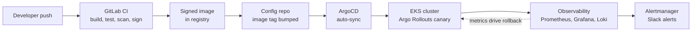

# eks-gitops-platform

A production-style delivery platform for a corporate bank. It provisions AWS EKS
with Terraform, delivers change through GitLab CI and ArgoCD, rolls releases out
gradually with automated rollback, and runs a centralised observability,
secrets, cost and disaster-recovery stack, all defined as code.

The question it answers is the one a bank platform team lives with: application
teams push code all the time, so how does that code reach customers safely, with
every change controlled, reversible, observed and auditable.

**Status:** Phase 1 in progress. See the phase table below.

## Why this exists

A corporate and investment bank runs most of its services on a shared platform.
The platform team is accountable for four things that also sit at the centre of
cloud-security and technology-risk work:

- **Safe change.** Code reaches production only through a controlled, auditable
  pipeline, never by hand. This is the core of SOX IT general controls and
  segregation of duties.
- **Reversibility.** Progressive delivery with automated rollback stops a bad
  change reaching every customer at once.
- **Resilience.** The platform is observed against service-level objectives, so
  failures are seen before customers feel them, and it can recover from loss.
- **Least privilege and auditability.** Infrastructure, access and policy are
  defined as code, reviewed and scanned before they are applied, and every
  action is logged.

This build demonstrates those properties end to end.

## Architecture



A developer's commit never reaches production by hand. It runs through the
pipeline, is deployed to the cluster by ArgoCD from Git, rolled out gradually,
and watched, with bad metrics triggering an automatic rollback.

## How it is proven, and at what cost

A permanently running multi-cluster EKS estate would cost well over 150 US
dollars a month and would not fit a development laptop. This build does not run
one. It proves the platform in three tiers, and every deliverable is labelled
with its tier:

- **Built live, briefly.** One real EKS cluster is brought up from Terraform,
  used to capture genuine AWS evidence (a load balancer, IAM roles for service
  accounts, ArgoCD syncing from Git, one real rollout), then destroyed the same
  day. The cost is a few dollars, not a monthly bill.
- **Proven locally, at zero cost.** The Kubernetes layer (ArgoCD, Argo Rollouts,
  Prometheus, Grafana, Loki, Alertmanager) runs on a local kind or k3d cluster.
- **Designed and documented.** Multi-environment separation, disaster recovery
  and the cost-optimisation automation are written as Terraform and runbooks,
  proven with validate, plan and a policy scan, and not left applied.

The repository is the deliverable. All code, manifests, pipelines, policies,
dashboards and runbooks are real and committed, whether or not a given layer is
running at the moment a reviewer looks.

## Phases

| Phase | Area | Tier | Status |
| --- | --- | --- | --- |
| 1 | Multi-environment Terraform foundation | Designed and validated | In progress |
| 2 | EKS cluster and workload identity | Built live, briefly | Planned |
| 3 | GitOps delivery (GitLab CI and ArgoCD) | Local and live | Planned |
| 4 | Progressive delivery and rollback | Local | Planned |
| 5 | Centralised observability | Local | Planned |
| 6 | Secrets management | Live, briefly | Planned |
| 7 | Cost-optimisation automation | Designed | Planned |
| 8 | Disaster recovery and backup | Designed and documented | Planned |
| 9 | Reporting and governance | Written | Planned |

## Repository layout

```
terraform/      modules, per-environment overlays, policy config
kubernetes/     application base, ArgoCD definitions, Argo Rollouts specs
helm/           values for the observability stack
ci/             GitLab CI pipeline: build, test, scan, sign
observability/  Grafana dashboards as code, SLO definitions, alert rules
cost/           idle-resource function or script, sample savings report
dr/             Velero config, backup schedules, restore runbook
docs/           phase guides and architecture decision records
evidence/       per-phase outputs and screenshots
report/         platform runbook, controls mapping, business report
```

## Running the local tier

The local tier needs Docker, kind or k3d, kubectl, Helm and the ArgoCD CLI. Each
phase guide under `docs/` lists its own steps. Nothing in the local tier touches
AWS or costs money.

## Cost and safety

- One EKS cluster is only ever brought up for a single evidence run and destroyed
  the same day, following the teardown checklist in `docs/02-eks-cluster.md`.
- Terraform owns every billable resource, so `terraform destroy` removes them.
- No secret is ever committed. `.gitignore` covers state, kubeconfig and `.env`,
  and a secret scan runs in the pipeline.

## Standards

The controls map to the NIST Secure Software Development Framework, SOX IT
general controls, and the operational-resilience expectations of the UK PRA and
FCA. The mapping is in `report/controls-mapping.md`.

## Licence

MIT. See `LICENSE`.
